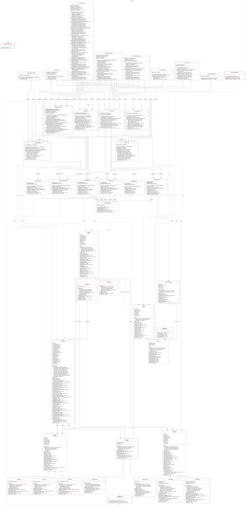

# VelvetBeauty – UML Class Diagram

Files: `class-diagram.drawio` (editable in draw.io), `class-diagram.png` (image), `class-diagram.svg` (zoomable vector), `class-diagram.mmd` (Mermaid source).

The diagram has all 42 classes in 5 packages (`app`, `controller`, `service`, `repository`, `model`), with every attribute, constructor and method taken from the Java source.

## Notation (SE1020 Lecture 04)

| Symbol | Meaning |
|---|---|
| `-` / `+` / `#` | private / public / protected |
| *italic* | abstract class or abstract method |
| underlined | static member |
| `«abstract»`, `«interface»` | stereotypes |

| Relationship | Drawn as | Where it appears in this project |
|---|---|---|
| Inheritance (is-a) | solid line, hollow triangle at the parent | `User` → `Customer`, `Admin`; `Customer` → `RegularCustomer`, `PremiumCustomer`; `Stylist` → `FullTimeStylist`, `PartTimeStylist`; `SalonService` → `HairService`, `SkinService`, `NailService`; `Review` → `PublicReview`, `VerifiedReview` |
| Interface realization | dashed line, hollow triangle at the interface | `Admin` implements `AdminPrivileges`; `AppointmentService` implements `AvailabilityChecker` |
| Association (has-a, one-way) | solid line with arrow, plus multiplicity | Fields holding another object: controller → service → repository → `FileStorageManager` (1 to 1). Domain links stored as IDs in the .txt files: `Appointment` 0..* → 1 `Customer` / `SalonService` / `Stylist`; `Review` 0..* → 1 `Customer` / `SalonService` / `Stylist`; `VerifiedReview` 0..1 → 1 `Appointment`; `AdminActivityLog` 0..* → 1 `Admin` |
| Dependency (uses temporarily) | dashed line with arrow | Repositories create model objects when they parse the .txt files; services use model objects in their methods; `Review.displayForUser(User)`; `GlobalControllerAdvice` → `User` |
| Composition / Aggregation | filled / hollow diamond | None in the code. No class creates or holds a "part" object; objects refer to each other by ID instead (for example `Appointment.customerId`) |

Getters and setters are included. Spring framework types (`HttpSession`, `Model`, `RedirectAttributes`) appear only as method parameters, and are not drawn as classes.
